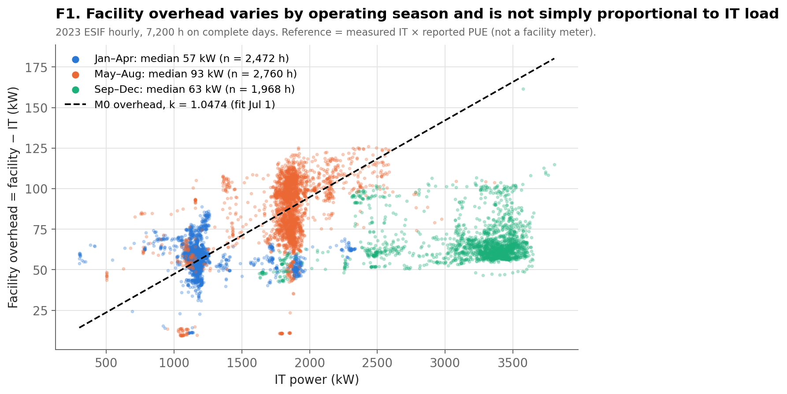
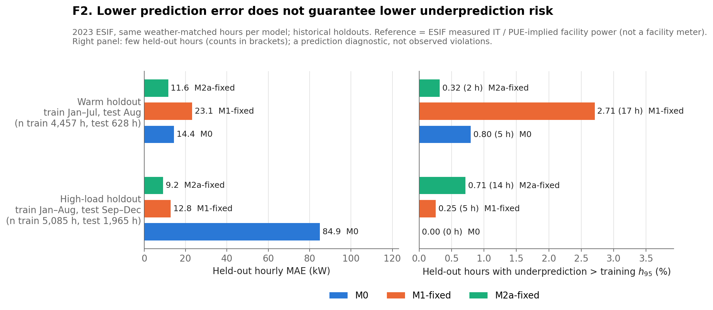
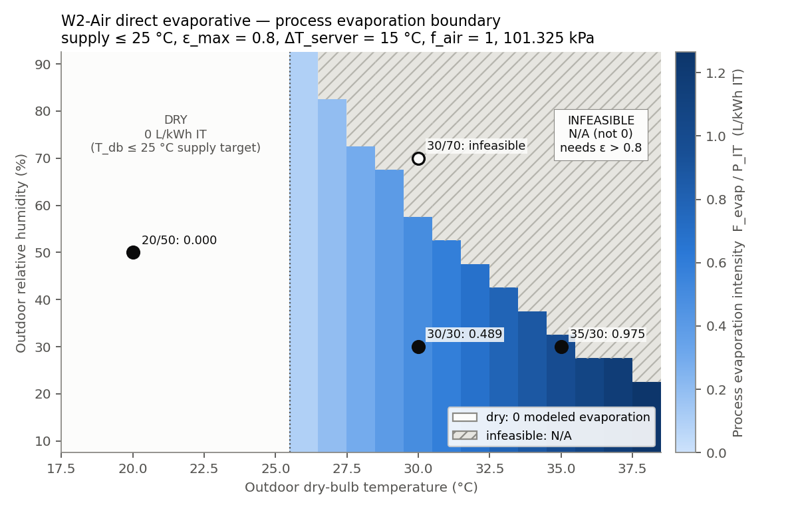
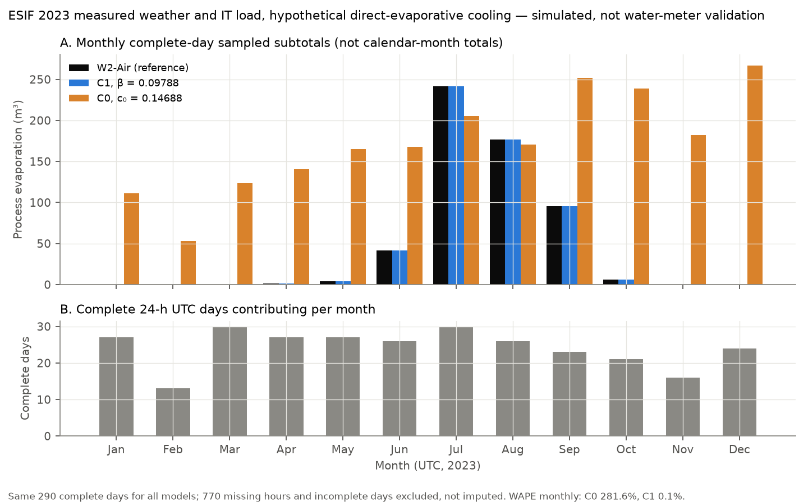
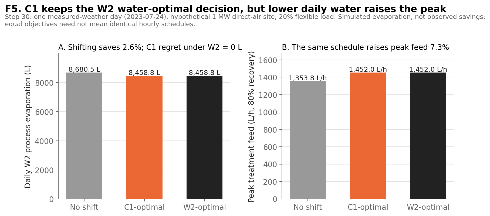

# Five-figure research summary

F1, F2, F5 and the supporting S1 are produced by `make_summary_figures.py`, which stops with an error if any numeric anchor does not match. F3 and F4 are linked unchanged from `../water_models/figures/`. None of these figures validates metered onsite cooling water or groundwater extraction. The five figures are a summary, not the full record: see `findings.md` for all Step 00–30 findings.

Run from the repository root: `python dc_resource_sim/eda/summary/make_summary_figures.py`

## F1. Facility overhead varies by operating season and is not simply proportional to IT load

*Source: `runs/esif_hourly_2023.csv` (ESIF measured IT × reported PUE, 7,200 hours on complete 2023 days); k from `runs/m0_daily.csv` (July 1).*
- **Observation:** Median overhead is 57 kW (Jan–Apr), 93 kW (May–Aug) and 63 kW (Sep–Dec), with little trend in IT load. A constant PUE (M0) makes overhead proportional to IT, so it overpredicts at the high IT loads of Sep–Dec and misses the summer rise.
- **Limitation:** The reference is PUE-implied, not a facility meter. Season stands in for weather and operations; it is not a causal attribution.

## F2. Lower prediction error does not guarantee lower underprediction risk

*Source: ESIF measured IT power, with a facility reference implied by PUE. 2023 data, 7,050 weather-matched hours. Warm holdout: train Jan–Jul (4,457 h), test Aug (628 h). High-load holdout: train Jan–Aug (5,085 h), test Sep–Dec (1,965 h).*
- **Observation:** Among the three plotted models, M2a-fixed has the lowest MAE in both holdouts (11.6 and 9.2 kW); unrestricted M2a (not plotted) is slightly better on the warm holdout (11.4 kW). The headroom ranking is different: under high load, M0 never exceeds its training h95 but has an MAE of 84.9 kW because it overpredicts.
- **Limitation:** These are two historical splits, and the reference is PUE-implied rather than a facility meter. Exceeding h95 rests on 0–17 hours per model and is a prediction diagnostic, not an observed capacity violation or a guaranteed coverage level.

## F3. Humidity determines evaporative feasibility

*Source: conditional W2-Air simulation (supply ≤ 25 °C, ε_max = 0.8).*
- **Observation:** Inside the feasible region, dry-bulb temperature sets the modeled evaporation intensity. Relative humidity mostly decides whether that region is feasible at all.
- **Limitation:** This holds for this architecture and controller only. It is not a universal law of RH independence, and the map does not show site water use or how often each weather condition occurs.

## F4. C1 tracks the seasonal shape of simulated evaporation; constant C0 does not

*Source: `../water_models/aggregation_summary.csv`. Conditional W2-Air simulation on ESIF 2023 weather and IT, 290 complete UTC days (6,960 hours). Monthly bars are sampled complete-day subtotals, not calendar-month totals.*
- **Observation:** C1's WAPE is 0.19% hourly, 0.14% daily and 0.10% for sampled months, and its peak error is +13.8 L/h. Frozen C0 errs 400%, 334% and 282% because it assigns water to winter months when W2 has none.
- **Limitation:** C1 approximates evaporation generated by W2, not meter readings. C0 was frozen on a different synthetic state distribution, so this does not rule out every constant-intensity calibration.

## F5. C1 keeps the W2 water-optimal decision, but lower daily water raises the peak

*Source: `../water_models/schedule_decision_summary.csv` (Step 30). Hypothetical 1 MW direct-air site, 2023-07-24 ESIF weather, 20% flexible load, 80% recovery.*
- **Observation:** C1- and W2-optimal schedules both reach 8,458.8 L of W2 evaporation, against 8,680.5 L with no shift: 221.7 L/day (2.6%) less, with zero C1 regret. Peak treatment feed rises from 1,353.8 to 1,452.0 L/h (+7.3%), so the lower daily volume comes with a higher peak.
- **Limitation:** One simulated day of process evaporation, not observed savings. Zero regret shows decision equivalence in this one scenario, not general equivalence of C1 and W2; equal objectives need not mean identical hourly schedules.

## Supporting figures
- `figures/s1_cost_gridwater_decision.png` (Step 15–16): the water-optimal schedule cuts modeled grid water by 122.5 L/day (~0.2%) for +$31.23/day, and the ranking reverses at a ±0.0239 L/kWh factor error. Its three points are transcribed from the verified Step 15 record, not regenerated.
- `../water_models/figures/02_heat_water_by_architecture.png` (architecture boundaries) and `05_airflow_control_transfer.png` (where C1 fails when ΔT_server changes).

## Conclusion
Additional model detail is valuable when it changes prediction under relevant conditions (F1–F2), physical feasibility (F3) or optimization decisions. A simple temperature-excess model is sufficient for aggregate water and for the tested scheduling decision (F4–F5), yet a schedule that lowers daily water can raise peak water demand (F5).
